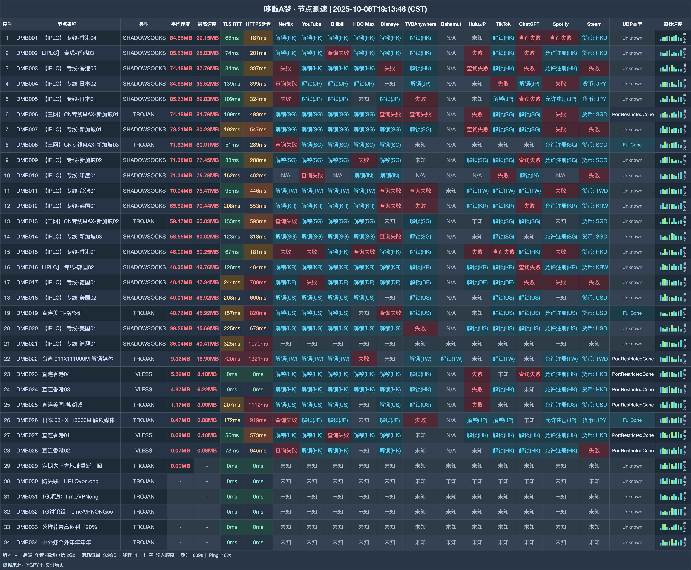

# 哆啦A梦机场｜135G 月付 23 元，V5 可用 AI 专线与家宽（2026-10-31 更新）

> **一句话结论：普通月付和不限时大包都覆盖，升级到 V5 后再解锁专属线路**
>
> 👉 **[官网注册](https://web1.yyds2-doraemon.site/login/register?invite_code=1yjj7VQR)** · 日常轻量使用先买 23 元 Vip2，明确需要 V5 权益再升级。

### 适合把这些放在前面：

- 想用 IPLC 和多地区节点
- 需要月付，也可能购买不限时流量
- 看重 V5 的 AI 专线及家宽节点

### 这些需求会被规则卡住：

- 使用 Vip2 还要跑 BT
- 希望多人共用 Vip3 或更高的个人套餐

| 选购项 | 结论 |
|---|---|
| 月付起价 | 23 元 / 135G |
| 月付容量 | 135G—1024G |
| 不限时容量 | 512G—6000G |
| 月付设备 | 2—5 台 |
| 协议 | Trojan · VLESS · Shadowsocks |
| V5 权益 | AI 专线 · 家宽节点 |

**认识一下这家机场**：哆啦A梦也常写作 doraemon，23 元 Vip2 是最低月付入口；V5 档加入 AI 专线和家宽节点，同时提供 512G—6000G 不限时包。

## 全部套餐怎么卖

| 套餐名称 | 费用 | 流量与周期 | 设备数 | 速度 | 购买须知 |
|---|---:|---:|---:|---:|---|
| Vip2 135G会员 | ¥23/月付 | 135G / 每月订单日重置 | 2 | 目前不限但可能限速 | 禁止BT，无退款 |
| Vip3 230G会员 | ¥34/月付 | 230G / 每月订单日重置 | 3 | 目前不限但可能限速 | 不限制正常BT，禁止共享，无退款 |
| Vip4 350G会员高速 | ¥45/月付 | 350G / 每月订单日重置 | 4 | 目前不限但可能限速 | 不限制正常BT，禁止共享，无退款 |
| Vip5 1024G会员超高速 | ¥90/月付 | 1024G / 每月订单日重置 | 5 | 500M | 原文500M，V5专属AI专线和家宽，不限制正常BT |
| Vip5 512G不限时间 | ¥120/一次性 | 512G / 用完为止 | 不限 | 不限 | 所有节点+V5专属AI专线和家宽，不限制BT，禁止共享 |
| Vip5 1200G不限时间 | ¥240/一次性 | 1200G / 用完为止 | 不限 | 不限 | 所有节点+V5专属AI专线和家宽，不限制BT，禁止共享 |
| Vip5 2400G不限时间 | ¥480/一次性 | 2400G / 用完为止 | 不限 | 不限 | 所有节点+V5专属AI专线和家宽，不限制BT，禁止共享 |
| Vip5 6000G不限时间 | ¥1100/一次性 | 6000G / 用完为止 | 不限 | 不限 | 此档无佣金，不限制BT，禁止共享 |
| 独享海外直播专用定制家宽 | ¥9999/月付 | 10G / 仅能购买一次 | 1 | 1000M | **定制展示项**，不可续费，无偿赞助商务无需付款，禁止BT，测速请错峰，不是普通可购套餐 |

> Vip2 禁止 BT；Vip3、Vip4 与不限时档禁止共享。Vip5 月档速度原文为 500M，按原字段保留；6000G 不限时档不产生本站佣金。

## 节点测速一览

测试收录 **34 个节点**，内容覆盖下载与延迟；测试端为 **华南-深圳电信 2Gb**，逐行结果放在下图。

## 先定等级，再定周期

1. 一个人轻度使用，23 元 Vip2 给 135G 和 2 台设备，先从这一档开始。
2. 需要 3—4 台设备时再升 Vip3 / Vip4，对应每月 230G / 350G，且不能共享。
3. 用量跨月波动大，可以从 120 元 512G 不限时包起选；续费不会自动重置流量。

## 从这里注册

👉 **[官网注册](https://web1.yyds2-doraemon.site/login/register?invite_code=1yjj7VQR)** · 日常轻量使用先买 23 元 Vip2，明确需要 V5 权益再升级。

*本文含推广链接；通过本文入口注册或购买，本站可能获得佣金。*

## 本文更新记录

- **2026-10-31** — 核对 9 个套餐/展示项，完成价量与限制整理。
- **2025-10-06** — 生成 B 版节点测速图，共 34 行。

---
*套餐、节点和活动可能调整，最终以购买页为准。*

展开相关搜索词

相关关键词：哆啦A梦、doraemon、哆啦A梦机场、哆啦机场、yyds2、机场推荐、机场测评、机场推荐2026、科学上网、代理、VPN、clash 订阅、哆啦A梦官网、哆啦A梦注册、哆啦A梦测速

